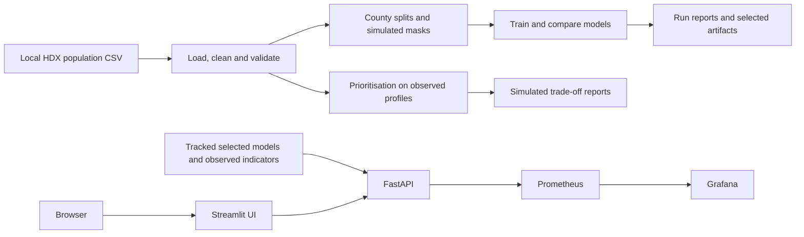

# Kenyan demographic reconstruction and county prioritisation

This capstone explores reconstructing incomplete county-level demographic profiles and
comparing simulated prioritisation strategies. It uses FastAPI, a purple-themed Streamlit
interface with light and dark modes, and Docker.

The project asks two separate questions: how accurately can deliberately hidden age-sex
population counts be estimated, and how do simulated county selections change with planning
priorities? The reconstruction uses 2019 data; the planning simulation uses **observed**
county profiles, not reconstructed predictions. Both are experimental decision-support
tools, not official population statistics or real funding decisions.

## Status

The local data pipeline, model selection, FastAPI service, Streamlit interface and local Docker
monitoring stack are implemented. The API and UI are deployed on Render; the latest local
changes are not necessarily deployed until they have been committed and deployed.

- Public application: https://aml-capstone-ui.onrender.com/
- Public API documentation: https://aml-capstone-api-98go.onrender.com/docs
- API health: https://aml-capstone-api-98go.onrender.com/health

The public services can sleep on Render's free tier and may take time to wake. The local
Prometheus and Grafana stack is not deployed by the Render Blueprint. A public monitoring
status page has not yet been confirmed.

## Architecture



Training writes isolated run artifacts; it does not automatically replace the tracked models
used by the API. Local Compose connects the UI to the API and runs Prometheus and Grafana.
The Render Blueprint configures only the API and UI; it does not deploy the monitoring stack.

## Submission files

- Project documentation and reproduction instructions: this README.
- AI assistance disclosure: [AI_USE.md](AI_USE.md).
- Reproducible data and training pipeline: [run_pipeline.py](run_pipeline.py),
  [config.yaml](config.yaml), and the modules under [src/](src/).
- Model training and selected artifacts: [src/models/](src/models/) and
  [models/selected/](models/selected/); the current selected family is random forest.
- Container configuration: [Dockerfile.api](Dockerfile.api), [Dockerfile.ui](Dockerfile.ui)
  and [docker-compose.yml](docker-compose.yml).
- API implementation: [src/api/](src/api/).
- Exploratory analysis and results: [notebooks/capstone_analysis.ipynb](notebooks/capstone_analysis.ipynb).
- Final [slide deck](docs/presentation/presentation.pdf) and
  [presenter's guide](docs/presentation/presenter_guide.pdf), with editable
  [slide source](docs/presentation/presentation.tex) and
  [guide source](docs/presentation/presenter_guide.tex).

To rebuild the presentation PDFs, install a LaTeX distribution with Beamer, TikZ and
the other packages named in the sources. From `docs/presentation`, run `pdflatex
-interaction=nonstopmode -halt-on-error presentation.tex` twice, then run the equivalent
command twice for `presenter_guide.tex`. The SHAP image in that directory is needed by the
slide deck. The PDFs capture the reported validation results; they do not automatically
update if the models or input data change.

## Data

The source is the [HDX HAPI population dataset](https://data.humdata.org/dataset/hdx-hapi-population).
Download the global non-HRP population CSV separately and place it at
`data/raw/hdx_hapi_population_global_non_hrp.csv`. Local files in `data/` are ignored by Git.
The supplied extract contains Kenya's 47 admin-1 counties for the 2019 reference period. A
different extract can be specified with `--input`; it must contain all 47 county codes and one
reference period. Inspect its source and reference period before comparing results.

Run the standalone loader from the repository root to verify the local file:

```powershell
python -m src.data.load
```

For another file, use `python -m src.data.load --input path/to/file.csv`. The loader checks
required columns and the 47 Kenya admin-level-1 county codes, and logs the file's SHA-256,
source shape and selected Kenya shape. The cleaner uses the same loader and performs additional
demographic and reference-period checks.

## Setup

Use Python 3.11, create and activate a virtual environment, then install the dependencies
needed for development. From PowerShell in the repository root:

```powershell
python -m venv .venv
.\.venv\Scripts\Activate.ps1
python -m pip install -r requirements-api.txt -r requirements-ui.txt -r requirements-dev.txt -r requirements-data.txt -r requirements-model.txt -r requirements-optimization.txt
```

The model dependencies support the tree baselines and SHAP explanations.
In Git Bash, activate with `source .venv/Scripts/activate` instead.

## Reproducible analysis notebook

Open `notebooks/capstone_analysis.ipynb` in VS Code using the project virtual environment, or
run `python -m jupyter lab` from the repository root. Install the Setup requirements first.
The notebook loads the local raw CSV, explores and checks it, and calls the same pipeline used
by `python run_pipeline.py`. A full run trains all candidates and may take substantial CPU time;
it creates a new, isolated output directory under `data/processed/pipeline-runs/` and does not
replace the artifacts used by the API. Review the saved selection before changing deployed models.

The notebook includes data distributions, missingness and source inconsistencies, all nine
masking scenarios, validation results, grouped cross-validation, a training-median reference
baseline, and the observed-profile optimisation. It also examines mean under- and
overestimation and illustrative asymmetric losses: one or two arbitrary cost units per person
under- or overestimated. These are sensitivity assumptions, not measured financial costs.
MAE, RMSE, bias and losses are per artificially masked cell; R² can be undefined for constant
targets. The MAE-selected model is not necessarily optimal for an asymmetric cost.

To reuse a complete run in PowerShell, set `AML_NOTEBOOK_RUN_DIR` to its absolute path before
starting Jupyter. Its configuration, raw and processed checksums must match; these checks do
not verify the code revision or dependency versions used to produce the original run. By default
the test counties remain reserved. After freezing the methodology and selection, explicitly set
`AML_EVALUATE_TEST=1` before launching Jupyter to calculate and save the final held-out
report. The original manifest describes the pipeline run and remains unchanged; the presence of
`reports/selected_test_diagnostics.csv` records the separate test evaluation. Do not tune the
model repeatedly against this report. For the equivalent standalone step:

```powershell
python -m src.models.diagnostics --input "data\processed\pipeline-runs\YOUR_RUN\data\kenya_county_population.csv" --model-dir "data\processed\pipeline-runs\YOUR_RUN\models\selected" --output "data\processed\pipeline-runs\YOUR_RUN\reports\selected_test_diagnostics.csv" --split test
```

Replace `YOUR_RUN` with the actual run directory name. The command refuses to overwrite an
existing report. The notebook's tables and charts can also be generated without Jupyter:

```powershell
python -m src.analysis_workflow --run-dir "data\processed\pipeline-runs\YOUR_RUN" --output-dir "data\processed\pipeline-runs\YOUR_RUN\reports\analysis-export"
```

The output directory must not already exist. Small county samples, simulated masks, source
inconsistencies and potential distribution shift mean that neither high scores nor grouped CV
can guarantee good future performance or the absence of overfitting. A negative R² indicates
performance worse than predicting the evaluation sample's mean; the separate median reference
uses only training counties.

## Cleaning and exploratory analysis

Run these commands from the repository root:

```powershell
python -m src.data.clean
python -m src.data.validate
python -m src.data.missingness
python -m src.data.eda
```

Cleaning filters the global file to Kenya admin level 1, validates county identifiers and
demographic categories, and produces one row per county in
`data/processed/kenya_county_population.csv`. Missing observations remain missing. Columns use
`population_{f|m|all}_{age}` with underscores in age ranges, `100_plus` for ages 100 and above,
and `all` for total age. Male, female, and combined-sex values are retained as reported; their
relationships are checked rather than assumed.

Validation writes `reports/consistency_checks.csv` and exits with an error if any complete
components do not add up. Checks with missing components are labelled incomplete, not
consistent. Missingness reports and interactive HTML figures are written to `reports/`. These
generated files and the processed dataset are ignored by Git and can be recreated locally.

## Features, splits and masking

After cleaning, run:

```powershell
python -m src.features.prepare
```

This writes nine experiments (three patterns and rates) for each county-grouped
train/validation/test split under `data/processed/experiments/`. The default seed is 42;
`--seed`, `--input`, and `--output-dir` can be used to change the defaults. With 47 counties,
the split has 33 training, 7 validation and 7 test counties. Each experiment writes separate
`inputs.csv`, `mask.csv` and `targets.csv` files, plus a shared `summary.json` recording the
requested rates and actual masked cell fractions. Targets are for scoring only, never predictors.
Do not combine differently masked versions of the same county across splits or experiments.

Random masking selects 10%, 20% or 40% of observed cells. Age-block masking selects that
percentage of available county-age blocks, hiding both available sex cells; county-block
masking selects that percentage of counties and hides all available age-sex cells in each.
Counts are rounded to the nearest whole unit, so actual cell fractions can differ, particularly
in the small validation and test splits. County-block cases have no observed demographic
inputs: reconstruction needs justified external information or an explicit baseline.

Features use only the 42 five-year/open-ended age-by-sex cells, not the source aggregate
totals, to avoid direct leakage through redundant totals. The denominator for shares is the sum
of these 42 cells, which can differ from a reported source total. County names and codes in the
output are identifiers for joining and auditing, not demographic model predictors. Male/female sex ratio, child
(0–14), working-age (15–64) and older (65+) shares, and dependency ratio are computed *after*
masking; incomplete components or zero denominators yield missing features. The audit checks
split isolation, masking, target separation and feature recomputation. It does not prove that
future model training is leakage-free: fit imputers, scalers and tuning only on training data,
and keep test data untouched until final evaluation.

## Tree baselines

After cleaning, run `python -m src.models.baselines`. Random Forest and XGBoost are tuned
independently for each masking pattern and rate using three-fold county-grouped CV on the
training split. Each training example predicts one masked age/sex cell from the remaining
masked profile and the target age/sex; missing inputs use a fixed -1 sentinel (populations are
non-negative). County identifiers, source totals and held-out values are not predictors. CV
uses only counties that actually have masked targets: at 10% county-block masking this means
only three training counties, so those results are particularly uncertain.

The script writes 18 model artifacts to `models/baselines/`, a validation results table and
training-sample SHAP plots to `reports/baselines/`, and input checksum/seed metadata in
`run.json`. These generated outputs are ignored by Git and can be recreated locally. The test
split is not evaluated here and must remain untouched until the final model is selected.
Consistency compares completed atomic cells against the original reported totals, including
existing source discrepancies; exact agreement is not assumed. MAE, RMSE and R² cover only
artificially held-out cells, not every cell in a reconstructed profile. Never load joblib
artifacts from untrusted sources.

## Masked autoencoder and selection

Install `requirements-model.txt`, then run these commands from the repository root after
cleaning the data:

```powershell
python -m src.models.baselines
python -m src.models.autoencoder
python -m src.models.compare_models
```

The autoencoder takes 42 masked age-sex values and 42 observed-value indicators. It predicts
non-negative age-sex cells, optimising masked-cell error plus a tunable consistency penalty.
The penalty uses reported age and gender totals **as training labels only**, not as inference
inputs. Consequently the autoencoder uses extra supervision that the tree baselines do not;
comparisons reflect that difference. No reported totals from validation or test counties are
used to predict their held-out cells. Validation consistency metrics compare predictions against
reported totals afterward, which themselves have documented source inconsistencies.

Hyperparameters are chosen with three-fold county-grouped CV on masked training counties; the
normalisation scale is fitted separately inside each training fold. The exact Phase 4 masks are
recreated using the same seed. The comparison rejects mismatched input checksums, seeds or
validation-mask fingerprints; rerun both training commands if either input or mask logic changes.

Selection chooses the family with the lowest **unweighted mean validation MAE across the nine
masking scenarios**, not the single easiest scenario. It saves that family's nine scenario-specific
artifacts, their comparison table and selection metadata to `models/selected/`. A caller must
select the corresponding pattern and rate; this is not yet a general-purpose deployed model.
The selection command refuses to overwrite a nonempty output directory; use `--output-dir` to
create a new selection. The final test split has not been evaluated. The validation set has only
seven counties and CV for 10% county-block has only three eligible training counties, so rankings
are preliminary. Autoencoder candidate artifacts and reports are regenerable and ignored by Git;
selected artifacts are intended to be tracked. Only load trusted model artifacts.

## Technique justification

The reconstruction problem is a small **tabular, cross-sectional** dataset: 47 county
profiles with 42 age-sex cells each, rather than a series of measurements over time.
Training, tuning and comparisons are performed per masking scenario with counties kept
separate between splits.

- **Random Forest** combines trees to model nonlinear associations between available
  profile values and a missing cell. It was selected because its unweighted mean MAE
  across the nine validation scenarios was lowest (5,582.32 people per masked cell).
  This is a validation-based choice, not proof it will be best on new counties.
- **XGBoost** provides a boosted-tree comparison that can also capture nonlinear
  relationships. The **masked autoencoder** tests a neural reconstruction approach;
  its use of reported totals as extra training supervision makes its information
  different from the tree models. A training-county median provides a simpler reference.
- **Weighted-sum optimisation** makes the effect of explicit planning weights easy to
  understand, while **NSGA-III** explores multiple trade-offs without relying on a
  single set of weights. Both use the same simplified objectives and budget.

The following alternatives were not implemented or benchmarked for this project; these
are design reasons for excluding them, not experimental claims that they perform worse:

- **LSTM or other temporal sequence models:** the input is a single 2019 snapshot,
  not a longitudinal sequence of county observations. Treating age bands as a time
  series would not supply the temporal evidence needed for forecasting.
- **Large language models (LLMs):** the task is numerical reconstruction from a small
  structured table, not text understanding. A generative language model would add
  complexity and potential unsupported numerical outputs without a demonstrated
  benefit for this dataset.
- **K-nearest-neighbour and multiple imputation:** these are plausible alternatives,
  but were outside the implemented comparison. Distance-based methods need careful
  scaling and handling of missing features; multiple imputation would require
  additional assumptions and uncertainty analysis. The training-median reference
  offers a simpler check, not a substitute for benchmarking these alternatives.
- **Other deep architectures:** the limited number of counties makes training and
  evaluating more complex neural models uncertain. The autoencoder is the neural
  approach explored here; further architectures would require a separately designed
  comparison and preferably more independent data.

## Limitations and responsible use

- The selected model's results are **validation**, not final test results: the seven
  test counties remain reserved. Seven validation counties and simulated masks limit
  confidence about new counties and real missingness. The 10% county-block tuning
  scenario has only three eligible training counties.
- The source contains 137 inconsistent checks among 1,175 complete total/component
  checks. These are checks, not counts of affected counties. The data are a 2019
  snapshot, so current populations may differ.
- The median reference has lower MAE in three of nine validation scenarios. MAE and
  RMSE describe error per artificially hidden cell, while R² is a comparison with
  the evaluation mean, not a percentage of correct predictions. Reproducibility
  checks do not prove generalisation or the absence of overfitting.
- Each saved reconstruction model corresponds to a particular pattern and rate.
  The selected scenario is not automatically checked against the uploaded gaps;
  whole-county gaps contain no observed demographic inputs. Predictions can be
  fractional and uploaded aggregate totals are not recalculated.
- The planning exercise uses observed profiles, equal simulated county costs and
  simplified objectives. Its dependency-ratio proxy is not a validated fairness
  measure, and neither its solutions nor hypervolume establish real-world impact.
- The public API lacks authentication and rate limiting. Do not upload sensitive
  data or use this deployment for production decisions. Public uptime monitoring
  and a status page have not been confirmed.

After freezing the methodology, evaluate the reserved test counties once, investigate
source discrepancies, compare with independent and more recent data, and seek domain
review before considering operational use.

## Simulated county prioritisation

After cleaning, run:

```powershell
python -m src.optimization.compare
```

The default simulation uses the **observed** complete 2019 county profiles, not reconstructed
data. It selects up to ten counties, with one simulated unit of cost per selected county; there
is no currency or real allocation implied. The budget, seed, generations and input file can be
specified with `--budget`, `--seed`, `--generations` and `--input`.

Indicators use the observed age-sex cells: children are ages 0–14, working age 15–64, elderly
65+, and dependency burden is (children + elderly) / working-age population. Incomplete profiles
or a zero working-age denominator are rejected. The objectives maximise the selected counties'
share of all children, share of all elderly people, and share of the sum of county dependency
ratios. The third objective is an **illustrative burden-based equity proxy**, not a proven
measure of fairness, need, service delivery or deprivation. All objectives treat selecting a
county as covering its entire indicated population; this is a simplifying assumption, not a
service-coverage estimate. Age-cell totals may differ from source aggregate totals.

The weighted-sum baseline solves each of 66 fixed weight combinations exactly for the equal-cost
budget. Binary NSGA-III approximates a nondominated front; solutions are not guaranteed globally
Pareto-optimal. Both methods use the same objectives and budget. Their hypervolumes use the same
fixed `[0.01, 0.01, 0.01]` reference point in minimisation coordinates (objectives are negated).
The result depends on the weight grid, stochastic search, seed and hypervolume reference point;
it does not establish real-world superiority. This phase deliberately does not use or evaluate
the selected reconstruction models.

Generated `indicators.csv`, `tradeoffs.csv`, `summary.json` and an interactive `tradeoffs.html`
are saved to `reports/prioritisation/` and ignored by Git. County selections are stored as JSON
arrays of county codes in the table. The decision maker must assess assumptions and trade-offs.

## Reproduction and deployment

### FastAPI service

Install the requirements files listed in Setup. The API requires the selected tree-model files
under `models/selected/` and the derived observed indicators in
`models/observed_county_indicators.csv`. Both are included in the repository, so the raw CSV
is not required to serve predictions. Only load model files from trusted sources; joblib
deserialization executes code. The current service supports the selected Random Forest or
XGBoost artifacts, not an autoencoder-selected family. The serialized models were trained
with scikit-learn 1.9.1, pinned in `requirements-model.txt`; if changing that version, retrain
and reselect artifacts because scikit-learn does not guarantee cross-version compatibility.

Start the API from the project root:

```powershell
python -m uvicorn src.api.main:app --host 127.0.0.1 --port 8000
```

Open `http://127.0.0.1:8000/docs` for the interactive request schemas. `/health` confirms that
startup artifacts loaded, `/counties` lists county identifiers, and `/indicators/{county}`
returns observed 2019 indicators by county code. `/reconstruct` requires all 42 age-sex keys,
with `null` for missing values, plus an explicitly selected `pattern` (`random`, `age-block`
or `county-block`) and `rate` (10, 20 or 40). It preserves observed cells and returns the
predicted keys separately; predictions are experimental and the selected scenario is not
automatically inferred or validated against the submitted mask. Input values must be finite and
between zero and one trillion.

`/prioritise` accepts an equal-cost simulated budget, three objective weights for the
weighted-sum baseline, a random seed and a generation count (1–200). It returns the weighted
solution and an approximate NSGA-III front over the *observed* indicators, not reconstructed
profiles. At most one optimisation runs per API process at a time; a simultaneous request
receives HTTP 503. These are decision-support simulations, not actual allocations. Indicators
can be regenerated from a processed dataset matching `models/selected/selection.json` using
`python -m src.api.export_indicators`.

CORS is disabled unless `AML_CORS_ORIGINS` is set to a comma-separated list of trusted browser
origins. `AML_MODEL_DIR` and `AML_INDICATORS_PATH` override the default artifact locations.
`/metrics` exposes Prometheus request counts, errors (including 4xx), request latency and
successful reconstruction counts. Metrics are in-process and reset on restart; persistent
history requires an external collector. The API currently has no authentication or public
rate limiting and should not be treated as a production service.

### Streamlit interface

Install the requirements files listed in Setup, ensure the API is running, then start the UI:

```powershell
streamlit run app/streamlit_app.py
```

The interface reads the API base URL from `AML_API_URL` and defaults to
`http://127.0.0.1:8000` if unset. It includes four pages:

The interface initially follows the browser/device light or dark preference. The sun/moon
button at the top overrides that choice for the current Streamlit session; open a new session
to follow the device setting again.

- **Fill missing numbers**: upload a processed CSV with one county per row and estimate
  missing age-sex values. Download the blank template on the page to see the required 42
  population column names. Leave missing cells empty (or use `NA` or `null`); zero is a
  known value. Up to 100 rows and 5 MB are accepted per upload. Other columns are retained,
  but aggregate totals are not recalculated and must be checked separately. Only the 42
  age-sex values are sent to the configured API, one incomplete row at a time.
- **Explore counties**: compare county figures and optionally upload licensed county boundaries
  for a map. The UI checks county codes against the API data.
- **Compare plans**: explore simulated county selections with different priorities.
- **Service status**: check service health, chart activity and compare two uploaded datasets.

Monitoring history is only stored in Streamlit session state and resets when the app restarts
or the browser session is cleared. The drift report is generated locally from uploaded files and
is not an automated production drift monitor.

### Docker Compose and monitoring

Install Docker Desktop with the Compose plugin, then run from the project root:

```powershell
docker compose up --build -d --wait
```

The Compose stack builds the API and Streamlit UI as slim, non-root images and starts Prometheus
and Grafana. Build contexts exclude the local `data/` directory; the API image includes only the
tracked selected model artifacts and observed indicator file it needs. All host ports bind to
localhost:

The `-d` flag runs the services in the background and returns you to the terminal; `--wait`
waits for the services to start or become healthy. Compose starts Streamlit automatically;
there is no separate Streamlit command when using Docker. The frontend is at
`http://127.0.0.1:18501` and the API documentation is at `http://127.0.0.1:18000/docs`.
The UI connects to the API inside the Compose network. Reload the frontend if it was open
while the containers were restarting.

The API image installs the runtime needed by the currently selected Random Forest models. If
`models/selected/selection.json` selects XGBoost instead, set `AML_INSTALL_XGBOOST=true` in the
environment before building (for PowerShell, use `$env:AML_INSTALL_XGBOOST = "true"`). The
optional XGBoost runtime is defined in `requirements-api-xgboost.txt`.

- UI: `http://127.0.0.1:18501`
- API health: `http://127.0.0.1:18000/health`
- API metrics: `http://127.0.0.1:18000/metrics`
- Prometheus: `http://127.0.0.1:19090`
- Grafana: `http://127.0.0.1:13000` (local-development default credentials: `admin` / `admin`)

If one of these host ports is already in use, override its `*_HOST_PORT` variable when starting
Compose: `API_HOST_PORT`, `UI_HOST_PORT`, `PROMETHEUS_HOST_PORT`, or `GRAFANA_HOST_PORT`.
For example, in Git Bash use `GRAFANA_HOST_PORT=13001 docker compose up --build -d --wait`
and open Grafana on port 13001. No fixed port can be guaranteed free on every machine.
Prometheus scrapes the API every 15 seconds. Grafana provisions a Prometheus datasource and an
API overview dashboard with request/error/prediction totals, request rates and latency. Named
volumes retain Prometheus and Grafana state between container restarts. Stop the services with
`docker compose down`; add `-v` only when intentionally deleting their stored monitoring data.
For non-local exposure, set a unique `GRAFANA_ADMIN_PASSWORD` and configure appropriate network
access and authentication first. This stack is for local development and does not make the API
production-secure.

### GitHub Actions and Render deployment

The CI workflow runs Ruff, the full test suite and Docker builds on every pull request. On pushes
to `main`, the deployment workflow reruns lint and tests, builds the API and UI images, publishes
SHA-specific and `main` tags to GHCR, and deploys the SHA-specific images through Render deploy
hooks. It waits for the API `/health` endpoint, verifies `/counties` and `/metrics`, then waits
for the Streamlit health endpoint and checks the public UI page. Any failed check fails the
workflow.

To configure deployment:

1. Merge this phase to `main`. The first workflow run publishes the SHA and `main` GHCR image
   tags; its Render deploy step will fail until the Render hooks and live URLs below are
   configured.
2. Make both GHCR packages public so Render can pull them without registry credentials. If you
   keep either package private, add a GHCR credential with `read:packages` access under Render
   Workspace Settings, then reference it in both image entries in `render.yaml`:
   ```yaml
   creds:
     fromRegistryCreds:
       name: capstone-ghcr
   ```
   Replace `capstone-ghcr` with the credential name configured in Render.
3. Connect this repository to Render and create/sync a Blueprint from `render.yaml`. It defines
   the API and UI as free Frankfurt web services using the published GHCR images.
4. In each Render service's **Settings**, create a deploy hook. Add the following repository
   **Actions secrets** under GitHub **Settings → Secrets and variables → Actions**:
   - `RENDER_API_DEPLOY_HOOK_URL`
   - `RENDER_UI_DEPLOY_HOOK_URL`
   - `LIVE_API_URL` — the API service base URL, e.g. `https://aml-capstone-api.onrender.com`
   - `LIVE_UI_URL` — the UI service base URL, e.g. `https://aml-capstone-ui.onrender.com`
5. Confirm the UI's `AML_API_URL` is set from the API service's private `hostport` by the
   Blueprint. The Streamlit client uses HTTP for that scheme-less inter-service address. Use the
   `https://` public service URL for `LIVE_API_URL`.
6. In GitHub Actions, manually run the **Deploy** workflow on `main` to perform the first
   configured deployment. Later pushes to `main` deploy automatically. The workflow requires
   the secrets above and successful lint/tests before publishing or deploying.

Render deploy hooks are credentials: never commit their URLs or paste them into workflow logs.
The workflow polls for up to 15 minutes per service; free Render services may sleep after
inactivity and take time to start. Confirm current free-tier quotas before deployment. This
Blueprint deploys the API and UI only; Prometheus/Grafana remain part of the local Docker Compose
stack. Public GHCR images and the API endpoints contain no authentication, so do not use this
deployment for sensitive or production workloads.

### End-to-end pipeline

Place the raw CSV as described above, install the requirement files, then run from the project
root:

```powershell
python run_pipeline.py
```

`config.yaml` sets the input, output root, fixed seed, simulated budget and optimisation
generations. Each invocation creates a new timestamped directory under
`data/processed/pipeline-runs/`; use `--run-name NAME` for a specific new directory or
`--config PATH` for another configuration. Existing run directories are never overwritten.
Changing the input or output paths to absolute paths is supported.

The pipeline loads and cleans the data, records the consistency report, prepares masks, trains
both model families, selects using validation results, and optimises **observed** profiles. It
logs a warning and continues when source totals are inconsistent or incomplete; the standalone
`src.data.validate` command remains strict. Check `reports/consistency_checks.csv` inside the
run directory. The manifest is written only on successful completion and records hashes, seed,
configuration, and check counts. Failed runs may leave partial files without a manifest; choose
a new run name for a retry. The pipeline does not overwrite the previously committed
`models/selected/` artifacts, and it does not evaluate the held-out test split.

The localhost addresses above are not publicly accessible. Use the public links in the status
section to access the deployed services.
